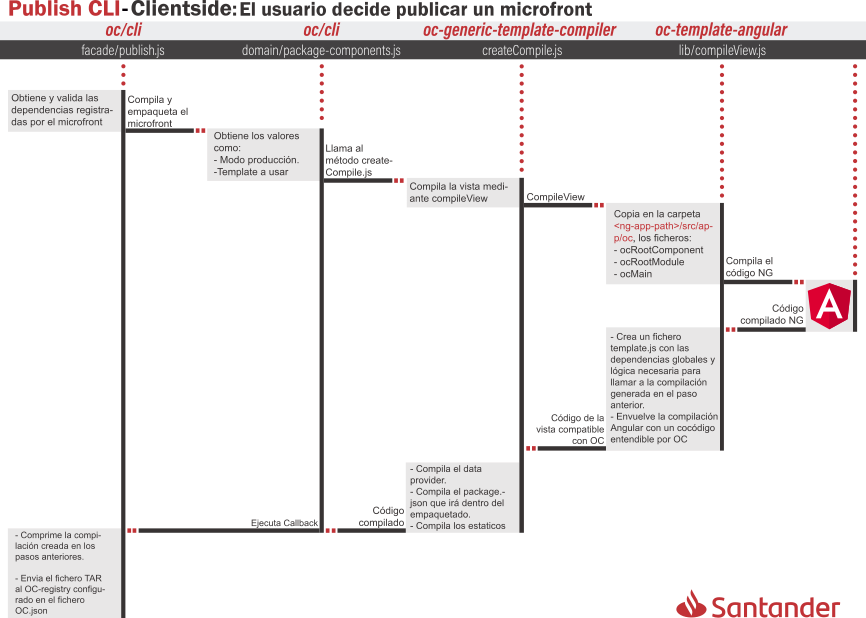
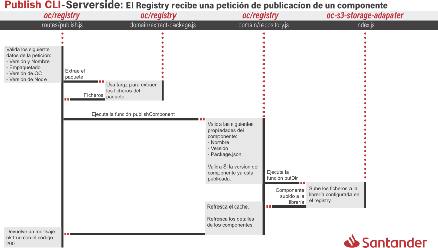

# oc-template-angular


Angular-templates para el sistema de templates de [OpenComponents](https://github.com/opentable/oc).

Basado en el trabajo de Nick Balestra en [oc-template-react](https://github.com/opencomponents/oc-template-react)

***

## Paquetes incluidos en este repositorio

| Name                                                                      | Descripción
|---                                                                        | ---
| [`oc-angular`](/packages/oc-template-angular)                             | Componentes, Modulos y Servicios usados por `oc-template-angular-compiler` durante la fase de compilación de un componente Angular.
| [`oc-angular-component-wrapper`](/packages/oc-angular-component-wrapper)  | Encargado de envolver la compilación de Angular.
| [`oc-template-angular`](/packages/oc-template-angular)                    | Pendiente
| [`oc-template-angular-compiler`](/packages/oc-template-angular-compiler)  | Encargado de Compilar el componente.


## Creación de un Microfront:

La manera habitual de crear un microfront con open components es a través del comando `oc init`. Sin embargo, Angular es un poco mas complejo y la lógica que ejecuta dicho comando es insuficiente. Ademas, pensamos que era mejor prescindir de dicho comando y tomar en cuenta a los proyectos basados en el CLI de Angular, por las siguientes razones:

- Para los proyectos ya existentes, es mas fácil agregar la lógica necesaria para transformar su SPA en un microfront que comenzar de cero.

- La mayoria de los proyectos Angular son creados a partir del CLI que provee el framework. En otras palabras, los proyectos basados en Angular tienen en común el fichero angular.json/angular-cli.json, una estructura de carpetas similar y son compilados usando el CLI de NG. Introducir otra forma de crear proyectos en el ecosistema Angular no tendría sentido.

Así que, si quieres utilizar el template de angular tendrás que ejecutar manualmente los siguientes pasos:

1. Copia el siguiente fragmento JSON: 

    ``` json
      "oc": {
        "parameters": {
          "name": {
            "default": "Joe",
            "description": "Your name",
            "example": "Jane Doe",
            "mandatory": false,
            "type": "string"
          },
          "complexParameter": {
            "default": "{\"test\":\"works\"}",
            "description": "complex object example",
            "example": "{\"test\":\"works\"}",
            "mandatory": false,
            "type": "string"
          }
        },
        "files": {
          "data": "src/app/server.ts",
          "template": {
            "src": "template.js",
            "type": "oc-template-angular"
          }
        }
      }

    ```

2. Pegalo en el `package.json` de tu proyecto y a continuacion modifica la propiedad `parameters` de acuerdo a tus necesidades. La propiedad files no la debes modificar.

    ### Nota:

    Si has echado un vistazo al fragmento JSON, te daras cuenta que los datos complejos son tambien de tipo `string`, esto se debe a que en las entrañas del template se realiza la transformación de dicho string a objeto. **Importante!**: Desde OC no se recomenda solicitar objetos complejos, siempre datos simples.

3. Instala las dependencias `oc-template-angular-compiler` y `@angular-builders/custom-webpack` como devDependencies mediante el siguiente comando: `npm i -D oc-template-angular-compiler @angular-builders/custom-webpack@8.4.1`

4. Modifica el fichero angular.json con los siguientes valores:

    - **prefix**: `<nombre-de-proyecto>`
    - **architect/build/builder**: @angular-builders/custom-webpack:browser
    - **architect/build/customWebpackConfig/path**: node_modules/oc-template-angular-compiler/lib/oc-webpack.config.js

5. Agrega el `OcModule` de la dependencia `oc-angular` al módulo raiz.

6. Descarga el fichero [`server.ts`](server.ts) y copialo en la ruta `src/app`

    ``` typescript
    import { Context } from 'oc-angular/src/oc-context.interface';

    export function data(context: Context, callback: (error: any, data: any) => void) {
        const { name, complex } = context.params;

        return callback(null, { name, complex });
    }

    ```

7. Finalmente, es necesario agregar el módulo `Router` aunque la SPA no tenga enrutamiento. Esto es debido a que los microfronts son usados por los consumidores con rutas que el microfront desconoce.

    Dicho Router deberia tener un contenido similar a este:

    ``` typescript
    const routes: Routes = [
      { path: '**', component: OcPatchRouteComponent },
    ];

    @NgModule({
      imports: [RouterModule.forRoot(routes)],
      exports: [RouterModule],
      providers: [{ provide: APP_BASE_HREF, useValue: '/' }]
    })
    ```

### conventions
- `props = server()` - the viewModel generated by the server is automatically passed to the react application as props
- The oc-client-browser is extended and will now expose all the available react-component at `oc.reactComponents[bundleHash]`
- You can register an event handler within the [oc.events](https://github.com/opentable/oc/wiki/Browser-client#oceventsoneventname-callback) system for the the `oc:componentDidMount` event. The event will be fired immediately after the react app is mounted.
- You can register an event handler within the [oc.events](https://github.com/opentable/oc/wiki/Browser-client#oceventsoneventname-callback) system for the the `oc:cssDidMount` event. The event will be fired immediately after the style tag will be added to the active DOM tree.

### externals
Externals are not bundled when packaging and publishing the component, for better size taking advantage of externals caching. OC will make sure to provide them at Server-Side & Client-Side rendering time for you.
- React
- ReactDOM
 
### features
- `Server Side Rendering` = server side rendering should work as for any other OpenComponent
- `css-modules` are supported.
- `post-css` is supported with the following plugins:
  - [postcss-import](https://github.com/postcss/postcss-import)
  - [postcss-extend](https://github.com/travco/postcss-extend)
  - [postcss-icss-values](https://github.com/css-modules/postcss-icss-values)
  - [autoprefixer](https://github.com/postcss/autoprefixer)
- `White list dependencies` to be inlcuded in the build process done by the compiler. To whitelist dependencies installed in the node_modules folder, add in the package.json of the component a `buildIncludes` list:
  ```json
    ...
    oc : {
      files: {
        template: {
          ...
          buildIncludes: ['react-components-to-build']
        }
      }
    }
  ```


## Utils

The compiler exposes some utilities that could be used by your React application:

### HOCs

#### withDataProvider

An Higher order component that will make a `getData` function available via props.

##### Usage:

```javascript
import { withDataProvider } from 'oc-template-angular-compiler/utils';

const yourApp = props => {
  // you can use props.getData here
};

yourEnhancedApp = withDataProvider(yourApp);
```

`getData` accept two arguments: `(params, callback) => callback(err, result)`. It will perform a post back request to the component endpoint with the specified query perams invoking the callback with the results.

For more details, check the [`example app`](/acceptance-components/react-app/app.js)

#### withSettingProvider

An Higher order component that will make a `getSetting` function available via props.

##### Usage:

```javascript
import { withSettingProvider } from 'oc-template-angular-compiler/utils';

const yourApp = props => {
  // you can use props.getSetting here
};

yourEnhancedApp = withSettingProvider(yourApp);
```

`getSetting` accept one argument: `settingName => settingValue`. It will return the value for the requested setting.

Settings available at the moment:
- `getSetting('name')` : return the name of the OC component
- `getSetting('version')` : return the version of the OC component
- `getSetting('baseUrl')` : return the [baseUrl of the oc-registry](https://github.com/opentable/oc/wiki/The-server.js#context-properties)
- `getSetting('staticPath')` : return the path to the [static assets](https://github.com/opentable/oc/wiki/The-server.js#add-static-resource-to-the-component) of the OC component




